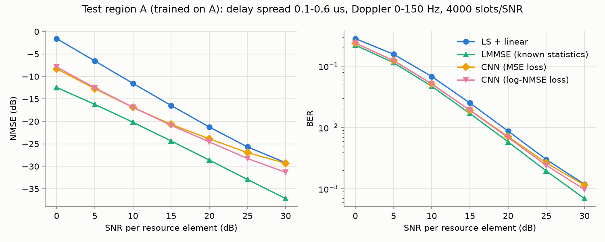

# Neural OFDM Channel Estimator with Embedded Deployment

> **Status: work in progress.** The CNN is trained and evaluated, its failure range is mapped
> and its building blocks are tested in ablations. It is exported to ONNX and quantized to int8;
> C++ inference and latency come next.

**Result so far:** On channels like its training data, a CNN with 5,378 parameters improves
the LS + linear channel estimate by 5.3 dB NMSE at 10 dB SNR, which is 1.2 dB SNR at a BER
of 1e-2 and 0.7 dB short of LMMSE with exact channel statistics. Its gain shrinks to 2.1 dB
at 30 dB SNR. On channels it has never seen (larger delay spread, higher Doppler) it clearly
helps only below 10 dB SNR and is up to 1.2 dB *worse* than LS + linear at 15-20 dB. A failure
map traces this to Doppler: the CNN smooths the channel over time by a nearly fixed amount,
whereas LMMSE adapts its smoothing to the channel. Ablations show that a tenth of the training
data nearly suffices, and that a model with 5.7 times fewer operations costs only 0.2 dB SNR
at that BER. Quantized to int8, the standard model loses at most 0.33 dB NMSE in region A and
0.01 dB SNR at that BER.

| Phase | Content | Status |
|---|---|---|
| 2 | Link-level simulation, LS / spline / LMMSE baselines | done |
| 3 | Neural estimator: data pipeline, model, training, evaluation, failure map, loss experiment, ablations | done |
| 4 | ONNX export, int8 quantization | done |
| 4 | C++ inference, latency | next |
| 5 | Browser demo on GitHub Pages | planned |

## Method

A time-domain link-level simulator generates slots of 14 OFDM symbols x 72 subcarriers
(15 kHz spacing, 128-point FFT, 9-sample cyclic prefix). QPSK or 16-QAM data shares the
grid with a staggered pilot lattice (symbols 0/4/7/11, every 6th subcarrier). The channel
is a sample-spaced tapped delay line with an exponential power delay profile and
per-tap Rayleigh fading from a sum-of-sinusoids (Jakes) model, followed by AWGN. The
receiver removes the CP, applies the FFT, estimates the channel, and equalizes with one tap
per resource element.

Channel conditions come in two regions, so that robustness claims can be checked:

| Region | Delay spread | Max. Doppler | Use |
|---|---|---|---|
| A | 0.1-0.6 us | 0-150 Hz | training + in-distribution test |
| B | 0.9-1.3 us | 300-600 Hz | out-of-distribution test |

### Neural estimator

The network refines the LS + linear estimate instead of estimating the channel from
scratch:

- **Input** (3 x 14 x 72): real and imaginary part of the LS + linear estimate, plus the
  SNR as a constant plane (`snr_db / 30`). The same function builds the input for
  training and inference ([`src/nn/dataset.py`](src/nn/dataset.py)).
- **Model** ([`src/nn/model.py`](src/nn/model.py)): four 3x3 convolutions
  (3-16-16-16-2 channels, ReLU) whose output is *added* to the LS + linear estimate. The
  last layer starts at zero, so the untrained model reproduces the baseline exactly.
  It has 9 x (3x16 + 16x16 + 16x16 + 16x2) = 5,328 weights plus 50 biases, so 5,378
  parameters, and needs 5,328 x 14 x 72 = 5.37 M multiply-accumulates per slot.
- **Data**: 32,000 training slots from region A with SNR uniform in 0-30 dB, generated
  in memory from fixed seeds (under 2 minutes on a laptop CPU) instead of being stored.
  Validation and test sets use separate seeds; region B is never used for training.
- **Training**: Adam with a log-NMSE loss, the mean NMSE in dB over the slots, so that every
  slot counts equally. It used the full 100 epochs, about 33 minutes on a laptop CPU
  ([training curve](results/training_A_log_nmse.png)). The best epoch is the last one, but the
  last 20 epochs only gained 0.04 dB. Validation NMSE over mixed SNR: -15.7 dB, against -9.8 dB
  for the network input.

Note on fairness: the network is given the exact SNR, the interpolation baselines are not.
[Without the SNR plane](#what-each-building-block-contributes) its gain in region A falls from
5.3 to 4.7 dB at 10 dB SNR and disappears at 30 dB.

## Reproduce

```bash
pip install -e ".[dev]"
pytest
python scripts/run_baselines.py --region A
```

The model tests and the CNN results need PyTorch (CPU is enough); the tests are skipped
without it. With PyTorch installed, the trained model in `models/` can be evaluated directly:

```bash
pip install torch --index-url https://download.pytorch.org/whl/cpu
python scripts/evaluate_nn.py --region A
```

`python scripts/train_nn.py` repeats the training with the same data and start weights. On the
laptop used here, a fresh process matched the logged values of the first two epochs exactly;
other machines or thread counts can differ slightly. Adding
`--nn-config configs/experiments/<name>.yaml` trains a variant.

The ONNX export and the int8 quantization need one more set of packages. The comparison takes
roughly half an hour on a laptop CPU:

```bash
pip install -e ".[deploy]"
python scripts/export_onnx.py
python scripts/compare_quantization.py
```

All parameters live in [`configs/default.yaml`](configs/default.yaml); every figure is
produced by a script from a fixed seed.

## Results

QPSK, 4000 independent test slots per SNR point, `python scripts/evaluate_nn.py --region A|B`.
The CNN was trained on region A only.


| NMSE (dB) | A @ 0 dB | A @ 10 dB | A @ 20 dB | A @ 30 dB | B @ 0 dB | B @ 10 dB | B @ 20 dB | B @ 30 dB |
|---|---|---|---|---|---|---|---|---|
| LS + linear | -1.6 | -11.5 | -21.3 | -29.2 | -1.4 | -10.2 | -14.9 | -15.9 |
| LS + spline | -0.1 | -10.1 | -20.0 | -28.9 | 0.0 | -9.2 | -15.2 | -16.7 |
| **CNN** | **-7.9** | **-16.9** | **-24.6** | **-31.3** | **-5.6** | **-10.0** | **-14.1** | **-16.2** |
| LMMSE (known statistics) | -12.4 | -20.2 | -28.6 | -37.2 | -7.5 | -14.4 | -21.8 | -26.5 |

| SNR needed for the target BER | LS + linear | CNN | LMMSE | Perfect CSI |
|---|---|---|---|---|
| Region A, BER 1e-2 | 19.4 dB | 18.2 dB | 17.5 dB | 16.9 dB |
| Region A, BER 3e-2 | 14.1 dB | 12.7 dB | 12.2 dB | 11.7 dB |
| Region B, BER 3e-2 | 16.0 dB | 17.6 dB | 13.5 dB | 11.9 dB |

**Region A (same conditions as in training).** The CNN gains 6.3 dB NMSE over LS + linear at
0 dB SNR, without being told the channel statistics. The gain then shrinks steadily to 2.1 dB
at 30 dB, while the distance to LMMSE grows from 3.3 dB at 10 dB to 5.8 dB at 30 dB.

**Region B (never seen in training).** The CNN still helps at low SNR (+4.2 dB at 0 dB) but is
worse than its own input at 15 and 20 dB, by up to 1.2 dB. At 10 and 25 dB it is about level,
within the noise between training runs, and at 30 dB it is 0.4 dB better. At a BER of 3e-2 this
costs 1.6 dB SNR compared to plain LS + linear; the section on failures below explains why.
**The model should not be used outside its training range without a check.**

**Classical baselines.** Both LS variants hit an error floor around -16 dB in region B: the
channel changes too much between pilot symbols for interpolation. LMMSE avoids the floor
because it knows the Doppler, but it needs exact statistics. Even perfect CSI shows a BER
floor in region B (1.4e-3 at 30 dB vs. 6e-4 in A), caused by inter-carrier interference and
delay taps beyond the cyclic prefix. Baselines alone: `scripts/run_baselines.py`.

### Does the training loss matter?

The first model used an unweighted MSE ([`configs/experiments/mse.yaml`](configs/experiments/mse.yaml))
and gained only 0.1 dB at 30 dB SNR. Its error energy is 127 times larger at 0 dB than at 30 dB,
so noisy slots dominate that loss. The log-NMSE loss tests whether this causes the weak gain.
Data and start weights are the same. All other results in this README use the log-NMSE model,
because it gains more on average over the SNR points (4.3 dB against 3.8 dB in region A).



| NMSE gain over LS + linear (dB) | 0 dB | 5 dB | 10 dB | 15 dB | 20 dB | 25 dB | 30 dB |
|---|---|---|---|---|---|---|---|
| Region A, MSE loss | 6.7 | 6.2 | 5.4 | 4.2 | 2.6 | 1.3 | 0.1 |
| Region A, log-NMSE loss | 6.3 | 6.0 | 5.3 | 4.4 | 3.3 | 2.6 | 2.1 |
| Region B, MSE loss | 4.3 | 1.9 | -0.4 | -1.8 | -1.6 | -0.7 | -0.1 |
| Region B, log-NMSE loss | 4.2 | 2.1 | -0.2 | -1.2 | -0.8 | -0.1 | 0.4 |

- **The loss is part of the explanation, not all of it.** At 30 dB in region A the gain rises from
  0.1 to 2.1 dB, for 0.4 dB less at 0 dB. The CNN is still 5.8 dB behind LMMSE there.
- **It does not fix region B.** The worst value improves from -1.8 to -1.2 dB, but the CNN stays
  worse than LS + linear at 15 and 20 dB. This fits the Doppler range being the main problem
  rather than the weighting of the slots.
- **Caveat:** one training run per loss, both over the full 100 epochs (best epochs 99 and 100).

### Where the CNN fails

`python scripts/failure_map.py`, 300 slots per cell and SNR. All estimators see the same slots.
Blue means the CNN is better than the reference, red means it is worse.


- **Doppler does the damage.** Without Doppler the CNN beats LS + linear at every delay spread
  and SNR in the map. A larger delay spread only shrinks its advantage: at 10 dB SNR the gain
  falls from 5.9 dB at 0.1 us to 1.0 dB at 1.5 us.
- **Where it turns harmful depends on the SNR.** Training only covered up to 150 Hz. The CNN
  falls behind LS + linear from 400-600 Hz at 10 dB SNR and from 300-500 Hz at 20 dB. At 30 dB
  the range is widest: from 200 Hz at 0.1 us but only from 800 Hz at 1.5 us. The largest loss in
  the map is 2.9 dB (20 dB SNR, 0.1 us, 600 Hz).
- **Inside its training range it is reliably better:** between 1.3 and 3.0 dB at 30 dB SNR, and
  more at lower SNR.

To check whether smoothing explains this, `python scripts/tracking_check.py` measures which
share of the true channel change over 3 OFDM symbols arrives in the estimate (1 = all of it;
noise does not bias this measure). Delay spread 0.3 us:

| Share of true change over time | 10 dB, 50 Hz | 10 dB, 600 Hz | 20 dB, 50 Hz | 20 dB, 600 Hz |
|---|---|---|---|---|
| LS + linear | 1.00 | 0.93 | 0.99 | 0.93 |
| CNN | 0.63 | 0.54 | 0.80 | 0.72 |
| LMMSE (known statistics) | 0.56 | 0.95 | 0.90 | 0.99 |

Smoothing itself is not the problem: at low Doppler LMMSE smooths at least as much at 10 dB
SNR. But LMMSE knows the Doppler and stops smoothing when the channel changes quickly, while
the CNN keeps smoothing at nearly the same strength. This fits the failure map. That the
fixed smoothing comes from training only on low Doppler is still an untested assumption;
training over a wider Doppler range would test it.

### What each building block contributes

`python scripts/compare_ablations.py`, on the same test slots as above. Each variant changes
one thing in the standard model and was trained once. The data variants get proportionally
more epochs, so that less data does not also mean less training.

| NMSE gain over LS + linear (dB) | A, 10 dB | A, 20 dB | A, 30 dB | B, 10 dB | B, 20 dB | B, 30 dB | SNR for BER 1e-2 in A |
|---|---|---|---|---|---|---|---|
| **Standard** (5,378 parameters, 32,000 slots) | **5.3** | **3.3** | **2.1** | **-0.2** | **-0.8** | **0.4** | **18.2 dB** |
| Other seed | 5.3 | 3.3 | 2.1 | 0.0 | -1.0 | 0.4 | 18.2 dB |
| No SNR plane | 4.7 | 3.1 | -0.1 | -0.5 | -4.2 | -5.0 | 18.2 dB |
| Small model (8 channels, 3 layers, 954 parameters) | 4.1 | 2.6 | 0.8 | 0.5 | -1.5 | -0.4 | 18.4 dB |
| 30 % of the data (9,600 slots) | 5.3 | 3.3 | 2.0 | -0.2 | -1.1 | 0.0 | 18.2 dB |
| 10 % of the data (3,200 slots) | 5.2 | 3.2 | 1.9 | -0.2 | -0.8 | 0.3 | 18.2 dB |

For comparison, LS + linear needs 19.4 dB SNR for a BER of 1e-2 in region A.

- **Noise between training runs sets the scale.** Over all seven SNR points the second seed
  differs from the standard model by at most 0.06 dB in region A and 0.14 dB in region B. Region B
  varies more than that suggests: an earlier run that stopped after 71 epochs was up to 0.6 dB
  lower at 20 dB, and from 15 dB on the 30 % model is worse than both the 10 % and the full
  model. Differences below about 0.5 dB in region B should not be read as real.
- **The SNR plane matters most at high SNR.** Without it the gain in region A disappears at
  30 dB, and in region B the model ends up 5.0 dB worse than LS + linear. At a BER of 1e-2 it
  costs only 0.06 dB SNR, so the main result does not depend on this input. The plane lets the
  network smooth less when the noise is low: at 600 Hz and 0.3 us, the share of the true change
  over time rises from 0.54 at 10 dB to 0.72 at 20 dB with the plane, but only from 0.52 to 0.54
  without it (`python scripts/tracking_check.py --model models/cnn_A_no_snr.pt --out results/no_snr`).
- **A much smaller model costs little at link level.** The small model needs 5.7 times fewer
  multiply-accumulates (0.94 M per slot) and loses 0.7-1.5 dB NMSE in region A, but only 0.2 dB
  SNR at a BER of 1e-2, because noise dominates the channel estimation error at that SNR. In
  region B it is neither clearly better nor worse: +0.7 dB at 10 dB, -0.7 to -1.0 dB from 20 dB
  on. In int8 it loses more of its gain, see [below](#int8-quantization).
- **Data is not the bottleneck.** With 10 % of the slots the gain in region A falls by 0.25 dB at
  30 dB and at most 0.13 dB elsewhere. More slots from region A are therefore unlikely to close
  the gap to LMMSE; whether a larger model would is untested. Early stopping ended the 10 % run
  after 849 epochs, so it got 21,225 gradient steps instead of 25,000.

### ONNX export

`python scripts/export_onnx.py` exports only the correction network; adding the correction to the
LS + linear estimate stays outside the model. That way the int8 quantization does not round the
estimate itself. The largest output difference to PyTorch over 100 validation slots is 1.4e-6 for
the standard model and 8.3e-7 for the small one. Evaluated in ONNX Runtime on the test slots above,
the standard model's NMSE differs by less than 1e-6 dB and its bit errors by at most 1 in 7.68
million bits per SNR point.

### int8 quantization

The same script quantizes both models with ONNX Runtime after training (static quantization, QDQ
format, no retraining), calibrated on 2,000 validation slots. `python scripts/compare_quantization.py`
evaluates them on the test slots above. Only the correction is int8: adding it to the LS + linear
estimate stays in floating point, so a purely integer receiver would need a wider format for that
step. Latency follows with the C++ inference.

| Region A: NMSE in dB | 0 dB | 10 dB | 20 dB | 30 dB | Largest NMSE loss | SNR for BER 1e-2 in A | SNR for BER 3e-2 in B | File |
|---|---|---|---|---|---|---|---|---|
| LS + linear | -1.57 | -11.53 | -21.25 | -29.20 | | 19.36 dB | 16.01 dB | |
| Standard, FP32 | -7.87 | -16.86 | -24.56 | -31.34 | | 18.16 dB | 17.63 dB | 30.2 KB |
| **Standard, int8** | **-7.56** | **-16.84** | **-24.48** | **-31.02** | **0.33 dB** | **18.17 dB** | **17.65 dB** | **16.5 KB** |
| Standard, int8, full value range | -7.85 | -16.77 | -24.18 | -30.20 | 1.15 dB | 18.24 dB | 17.84 dB | |
| Standard, int8, naive | -7.82 | -16.72 | -23.92 | -29.27 | 2.07 dB | 18.30 dB | 17.94 dB | |
| Small, FP32 | -6.37 | -15.63 | -23.82 | -30.03 | | 18.37 dB | 18.15 dB | 10.6 KB |
| Small, int8 | -6.15 | -15.47 | -23.32 | -29.29 | 0.77 dB | 18.49 dB | 18.17 dB | 9.3 KB |

The largest loss is over all seven SNR points of region A, against the FP32 version of the same
model. "Naive" means the addition inside the model, one weight step size per layer and the full
value range.

- **Done carefully, int8 costs little.** The standard model keeps 1.82 of its 2.15 dB gain over
  LS + linear at 30 dB. In region B it loses at most 0.14 dB, within the noise between training
  runs. All convolutions run as `QLinearConv`, so in integers; the tests check this on the graph
  ONNX Runtime really executes, because the file alone does not show it.
- **The naive way loses the gain at high SNR.** Only 0.07 dB remain at 30 dB. Moving the addition
  out and giving every filter its own step size brings back 0.93 dB, limiting the value range
  another 0.82 dB. In the naive model ONNX Runtime also leaves one convolution in floating point
  without a warning; the cause was not investigated.
- **The step size shows why.** At 30 dB the LS + linear error is about 0.025 per real or imaginary
  part. One step at the output is 0.026 with the full value range and 0.013 with the limited one.
  Rounding adds step^2 / 12 per part, which by calculation explains about half of the remaining
  0.33 dB. The rest has to come from the rounding inside the network.
- **The range is a compromise, chosen on validation slots.** Clipping rare values costs accuracy at
  low SNR, where they occur: 0.32 dB at 0 dB, against 0.03 dB with the full range. Of five ranges
  ([`results/quantization_percentile.csv`](results/quantization_percentile.csv)), covering 99.95 %
  of the values gives the smallest largest loss on validation slots: 0.33 dB, against 0.51 dB for
  both 99.9 % and 99.995 %. The neighbouring 99.98 % is only 0.05 dB behind, so the exact value
  should not be overread.
- **The small model suffers more.** It loses up to 0.77 dB, and at 30 dB only 0.10 dB of its gain
  over LS + linear remains. At a BER of 1e-2 it falls 0.32 dB behind the standard model, against
  0.21 dB in FP32.

### Limitations

- LMMSE is not a practical competitor here but an upper bound: it knows the exact per-slot
  PDP, Doppler and noise variance. A fair classical opponent with averaged statistics is
  still missing.
- The CNN results are for QPSK. Every variant was trained once; only the standard model has a
  second seed.
- The network gets the exact SNR. A real receiver has to estimate it, and the effect of an SNR
  error is not tested.
- Taps are sample-spaced (Ts = 0.52 us), so small delay spreads are coarsely resolved.
- NMSE is computed over all resource elements, including the pilot positions.
- Channels with a delay spread beyond the CP cause ISI that no estimator here can remove.
- Both interpolation baselines extrapolate linearly beyond the outermost pilots. Cubic
  extrapolation amplified the pilot noise by up to 18 dB at the grid edges.

## Repository layout

```
configs/            YAML configurations, variants in configs/experiments/
src/ofdm/           simulation, channel, baselines
src/nn/             training data, CNN model, training, estimator wrapper, export, quantization
models/             trained weights, ONNX exports and their int8 versions
tests/              pytest
cpp/                C++ inference, CMake, GoogleTest      (Phase 4)
web/                demo for GitHub Pages                 (Phase 5)
scripts/            entry points that produce results/
results/            plots and tables
.github/workflows/  CI
```

## License

MIT
