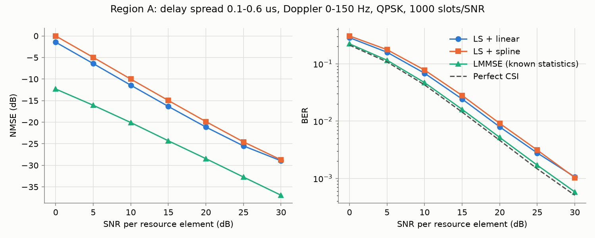
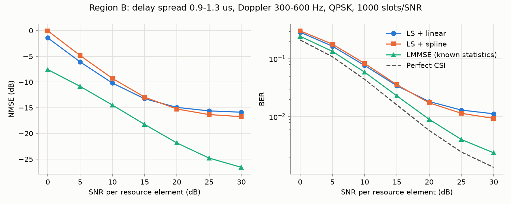

# Neural OFDM Channel Estimator with Embedded Deployment

> **Status: work in progress.** Simulator, baselines, training data pipeline and CNN model
> are done. Training and evaluation of the neural estimator come next.

**Result (to be filled in):** A small CNN refines the interpolated least-squares channel
estimate of an LTE-like OFDM link. It is compared against LS with linear and spline
interpolation and against LMMSE with known channel statistics, both on channels like the
training data and on deliberately different ones, and then quantized to int8 and run in C++.

| Phase | Content | Status |
|---|---|---|
| 2 | Link-level simulation, LS / spline / LMMSE baselines | done |
| 3 | Neural estimator: data pipeline and model | done |
| 3 | Neural estimator: training, evaluation, ablations | in progress |
| 4 | ONNX export, int8 quantization, C++ inference, latency | planned |
| 5 | Browser demo on GitHub Pages | planned |

## Method

A time-domain link-level simulator generates slots of 14 OFDM symbols x 72 subcarriers
(15 kHz spacing, 128-point FFT, 9-sample cyclic prefix). QPSK or 16-QAM data shares the
grid with a staggered pilot lattice (symbols 0/4/7/11, every 6th subcarrier). The channel
is a sample-spaced tapped delay line with an exponential power delay profile and
per-tap Rayleigh fading from a sum-of-sinusoids (Jakes) model, followed by AWGN. The
receiver removes the CP, applies the FFT, estimates the channel, and equalizes with one tap
per resource element.

Channel conditions come in two regions, so that robustness claims can be checked:

| Region | Delay spread | Max. Doppler | Use |
|---|---|---|---|
| A | 0.1-0.6 us | 0-150 Hz | training + in-distribution test |
| B | 0.9-1.3 us | 300-600 Hz | out-of-distribution test |

### Neural estimator

The network refines the LS + linear estimate instead of estimating the channel from
scratch:

- **Input** (3 x 14 x 72): real and imaginary part of the LS + linear estimate, plus the
  SNR as a constant plane (`snr_db / 30`). The same function builds the input for
  training and inference ([`src/nn/dataset.py`](src/nn/dataset.py)).
- **Model** ([`src/nn/model.py`](src/nn/model.py)): four 3x3 convolutions
  (3-16-16-16-2 channels, ReLU) whose output is *added* to the LS + linear estimate. The
  last layer starts at zero, so the untrained model reproduces the baseline exactly.
  5,378 parameters and 5.37 M multiply-accumulates per slot.
- **Data**: 32,000 training slots from region A with SNR uniform in 0-30 dB, generated
  in memory from fixed seeds (about 90 s on a laptop CPU) instead of being stored.
  Validation and test sets use separate seeds; region B is never used for training.
- **Bar to beat**: the network input itself has an NMSE of -9.8 dB on the training
  distribution.

Note on fairness: the network is given the SNR, the interpolation baselines are not. An
ablation without the SNR plane is planned to quantify this.

## Reproduce

```bash
pip install -e ".[dev]"
pytest
python scripts/run_baselines.py --region A
```

The model tests need PyTorch (CPU is enough) and are skipped without it:
`pip install torch --index-url https://download.pytorch.org/whl/cpu`.

All parameters live in [`configs/default.yaml`](configs/default.yaml); every figure is
produced by a script from a fixed seed.

## Results

### Classical baselines

QPSK, 1000 slots per SNR point, `python scripts/run_baselines.py --region A|B`.




| NMSE (dB) | A @ 10 dB | A @ 30 dB | B @ 10 dB | B @ 30 dB |
|---|---|---|---|---|
| LS + linear | -11.4 | -28.9 | -10.2 | -15.9 |
| LS + spline | -10.0 | -28.7 | -9.3 | -16.7 |
| LMMSE (known statistics) | -20.1 | -36.9 | -14.5 | -26.6 |

- In region A, LMMSE gains 8-11 dB NMSE over LS. In BER that is about 2 dB SNR at a
  BER of 1e-2, and LMMSE ends up within about 0.5 dB of perfect CSI.
- In region B, both LS variants hit an error floor around -16 dB from 20 dB SNR on: the
  channel changes too much between pilot symbols for linear or spline interpolation.
  LMMSE avoids the floor because it knows the Doppler, but it needs exact statistics.
- Even perfect CSI shows a BER floor in region B (1.3e-3 at 30 dB vs. 5e-4 in A),
  caused by inter-carrier interference and delay taps beyond the cyclic prefix.

The gap between LS and genie LMMSE is the room a learned estimator can try to close
without being told the channel statistics.

### Limitations

- Taps are sample-spaced (Ts = 0.52 us), so small delay spreads are coarsely resolved.
- The LMMSE baseline knows the exact per-slot PDP, Doppler and noise variance (genie).
- NMSE is computed over all resource elements, including the pilot positions.
- Channels with a delay spread beyond the CP cause ISI that no estimator here can remove.
- Both interpolation baselines extrapolate linearly beyond the outermost pilots. Cubic
  extrapolation amplified the pilot noise by up to 18 dB at the grid edges.

## Repository layout

```
configs/            YAML configurations
src/ofdm/           simulation, channel, baselines
src/nn/             training data and CNN model; training and ONNX export next
tests/              pytest
cpp/                C++ inference, CMake, GoogleTest      (Phase 4)
web/                demo for GitHub Pages                 (Phase 5)
scripts/            entry points that produce results/
results/            plots and tables
.github/workflows/  CI
```

## License

MIT
