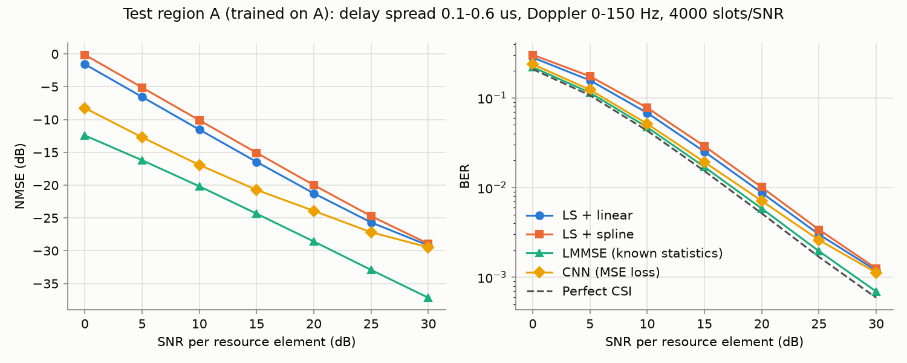
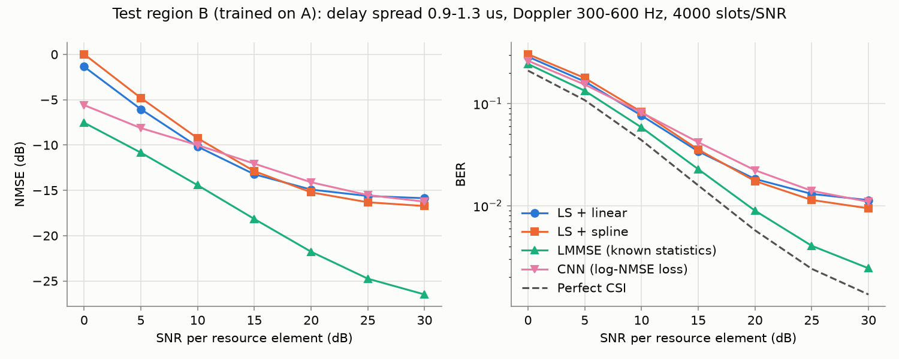
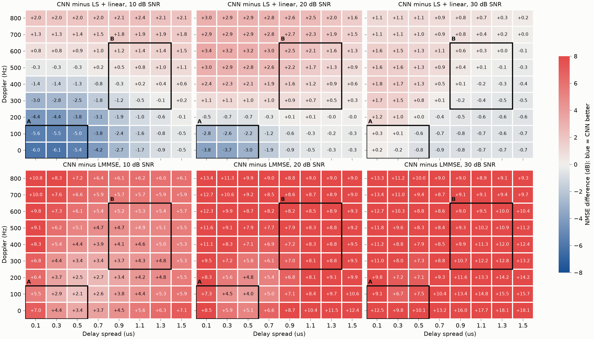

# Neural OFDM Channel Estimator with Embedded Deployment

> **Status: work in progress.** The CNN is trained and evaluated, and its failure range is
> mapped. A loss experiment, ablations and int8/C++ deployment come next.

**Result so far:** On channels like its training data, a CNN with 5,378 parameters improves
the LS + linear channel estimate by 5.4 dB NMSE at 10 dB SNR, which is 1.1 dB SNR at a BER
of 1e-2 and 0.8 dB short of LMMSE with exact channel statistics. Its gain shrinks to 0.3 dB
at 30 dB SNR. On channels it has never seen (larger delay spread, higher Doppler) it only
helps below about 10 dB SNR and is up to 1.8 dB *worse* than LS + linear above that. A
failure map traces this to Doppler: the CNN smooths the channel over time by a nearly fixed
amount, whereas LMMSE adapts its smoothing to the channel.

| Phase | Content | Status |
|---|---|---|
| 2 | Link-level simulation, LS / spline / LMMSE baselines | done |
| 3 | Neural estimator: data pipeline, model, training, evaluation, failure map | done |
| 3 | Neural estimator: loss experiment, ablations | next |
| 4 | ONNX export, int8 quantization, C++ inference, latency | planned |
| 5 | Browser demo on GitHub Pages | planned |

## Method

A time-domain link-level simulator generates slots of 14 OFDM symbols x 72 subcarriers
(15 kHz spacing, 128-point FFT, 9-sample cyclic prefix). QPSK or 16-QAM data shares the
grid with a staggered pilot lattice (symbols 0/4/7/11, every 6th subcarrier). The channel
is a sample-spaced tapped delay line with an exponential power delay profile and
per-tap Rayleigh fading from a sum-of-sinusoids (Jakes) model, followed by AWGN. The
receiver removes the CP, applies the FFT, estimates the channel, and equalizes with one tap
per resource element.

Channel conditions come in two regions, so that robustness claims can be checked:

| Region | Delay spread | Max. Doppler | Use |
|---|---|---|---|
| A | 0.1-0.6 us | 0-150 Hz | training + in-distribution test |
| B | 0.9-1.3 us | 300-600 Hz | out-of-distribution test |

### Neural estimator

The network refines the LS + linear estimate instead of estimating the channel from
scratch:

- **Input** (3 x 14 x 72): real and imaginary part of the LS + linear estimate, plus the
  SNR as a constant plane (`snr_db / 30`). The same function builds the input for
  training and inference ([`src/nn/dataset.py`](src/nn/dataset.py)).
- **Model** ([`src/nn/model.py`](src/nn/model.py)): four 3x3 convolutions
  (3-16-16-16-2 channels, ReLU) whose output is *added* to the LS + linear estimate. The
  last layer starts at zero, so the untrained model reproduces the baseline exactly.
  5,378 parameters and 5.37 M multiply-accumulates per slot.
- **Data**: 32,000 training slots from region A with SNR uniform in 0-30 dB, generated
  in memory from fixed seeds (about 90 s on a laptop CPU) instead of being stored.
  Validation and test sets use separate seeds; region B is never used for training.
- **Training**: Adam, MSE loss, 100 epochs, about one hour on a laptop CPU
  ([training curve](results/training_A.png)). Validation NMSE over mixed SNR: -15.9 dB,
  against -9.8 dB for the network input.

Note on fairness: the network is given the SNR, the interpolation baselines are not. An
ablation without the SNR plane is planned to quantify this.

## Reproduce

```bash
pip install -e ".[dev]"
pytest
python scripts/run_baselines.py --region A
```

The model tests and the CNN results need PyTorch (CPU is enough); the tests are skipped
without it. With PyTorch installed, the trained model in `models/` can be evaluated directly:

```bash
pip install torch --index-url https://download.pytorch.org/whl/cpu
python scripts/evaluate_nn.py --region A
```

`python scripts/train_nn.py` repeats the training.

All parameters live in [`configs/default.yaml`](configs/default.yaml); every figure is
produced by a script from a fixed seed.

## Results

QPSK, 4000 independent test slots per SNR point, `python scripts/evaluate_nn.py --region A|B`.
The CNN was trained on region A only.




| NMSE (dB) | A @ 0 dB | A @ 10 dB | A @ 20 dB | A @ 30 dB | B @ 0 dB | B @ 10 dB | B @ 20 dB | B @ 30 dB |
|---|---|---|---|---|---|---|---|---|
| LS + linear | -1.6 | -11.5 | -21.3 | -29.2 | -1.4 | -10.2 | -14.9 | -15.9 |
| LS + spline | -0.1 | -10.1 | -20.0 | -28.9 | 0.0 | -9.2 | -15.2 | -16.7 |
| **CNN** | **-8.2** | **-16.9** | **-23.9** | **-29.5** | **-5.6** | **-9.6** | **-13.5** | **-15.9** |
| LMMSE (known statistics) | -12.4 | -20.2 | -28.6 | -37.2 | -7.5 | -14.4 | -21.8 | -26.5 |

| SNR needed for the target BER | LS + linear | CNN | LMMSE | Perfect CSI |
|---|---|---|---|---|
| Region A, BER 1e-2 | 19.4 dB | 18.3 dB | 17.5 dB | 16.9 dB |
| Region A, BER 3e-2 | 14.1 dB | 12.7 dB | 12.2 dB | 11.7 dB |
| Region B, BER 3e-2 | 16.0 dB | 18.2 dB | 13.5 dB | 11.9 dB |

**Region A (same conditions as in training).** The CNN gains 6.7 dB NMSE over LS + linear at
0 dB SNR, without being told the channel statistics. The gain then shrinks steadily to 0.3 dB
at 30 dB, while the distance to LMMSE grows from 3.3 dB at 10 dB to 7.7 dB. A likely cause is
the training loss: the error energy is 133 times larger at 0 dB than at 30 dB, so an
unweighted MSE is dominated by noisy slots. This has not been tested yet.

**Region B (never seen in training).** The CNN still helps at low SNR (+4.2 dB at 0 dB) but is
worse than its own input from 10 to 25 dB, by up to 1.8 dB, and level with it at 30 dB. At a
BER of 3e-2 this costs 2.2 dB SNR compared to plain LS + linear; the section on failures below
explains why. **The model should not be used outside its training range without a check.**

**Classical baselines.** Both LS variants hit an error floor around -16 dB in region B: the
channel changes too much between pilot symbols for interpolation. LMMSE avoids the floor
because it knows the Doppler, but it needs exact statistics. Even perfect CSI shows a BER
floor in region B (1.4e-3 at 30 dB vs. 6e-4 in A), caused by inter-carrier interference and
delay taps beyond the cyclic prefix. Baselines alone: `scripts/run_baselines.py`.

### Where the CNN fails

`python scripts/failure_map.py`, 300 slots per cell and SNR. All estimators see the same slots.
Blue means the CNN is better than the reference, red means it is worse.



- **Doppler does the damage.** Without Doppler the CNN is never clearly worse than LS + linear,
  at any delay spread (at most +0.2 dB). A larger delay spread only removes its advantage: at
  10 dB SNR the gain falls from 6.0 dB at 0.1 us to 0.5 dB at 1.5 us.
- **The higher the SNR, the earlier it turns harmful.** The CNN falls behind LS + linear from
  about 400-500 Hz at 10 dB SNR and from about 200-300 Hz at 20 dB. Training only covered up
  to 150 Hz. The largest loss in the map is 3.4 dB (20 dB SNR, 0.1 us, 600 Hz).
- **At 30 dB there is hardly any gain, even in region A:** between +0.3 and -0.8 dB.

To check whether smoothing explains this, `python scripts/tracking_check.py` measures which
share of the true channel change over 3 OFDM symbols arrives in the estimate (1 = all of it;
noise does not bias this measure). Delay spread 0.3 us:

| Share of true change over time | 10 dB, 50 Hz | 10 dB, 600 Hz | 20 dB, 50 Hz | 20 dB, 600 Hz |
|---|---|---|---|---|
| LS + linear | 1.00 | 0.93 | 0.99 | 0.93 |
| CNN | 0.62 | 0.52 | 0.77 | 0.71 |
| LMMSE (known statistics) | 0.56 | 0.95 | 0.90 | 0.99 |

Smoothing itself is not the problem: at low Doppler LMMSE smooths at least as much at 10 dB
SNR. But LMMSE knows the Doppler and stops smoothing when the channel changes quickly, while
the CNN keeps smoothing at nearly the same strength. This fits the failure map. That the
fixed smoothing comes from training only on low Doppler is still an untested assumption;
training over a wider Doppler range would test it.

### Limitations

- LMMSE is not a practical competitor here but an upper bound: it knows the exact per-slot
  PDP, Doppler and noise variance. A fair classical opponent with averaged statistics is
  still missing.
- The CNN results are for QPSK and one training run with one seed.
- Taps are sample-spaced (Ts = 0.52 us), so small delay spreads are coarsely resolved.
- NMSE is computed over all resource elements, including the pilot positions.
- Channels with a delay spread beyond the CP cause ISI that no estimator here can remove.
- Both interpolation baselines extrapolate linearly beyond the outermost pilots. Cubic
  extrapolation amplified the pilot noise by up to 18 dB at the grid edges.

## Repository layout

```
configs/            YAML configurations
src/ofdm/           simulation, channel, baselines
src/nn/             training data, CNN model, training, estimator wrapper
models/             trained weights
tests/              pytest
cpp/                C++ inference, CMake, GoogleTest      (Phase 4)
web/                demo for GitHub Pages                 (Phase 5)
scripts/            entry points that produce results/
results/            plots and tables
.github/workflows/  CI
```

## License

MIT
